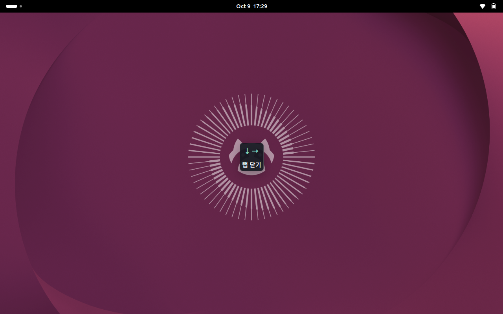

# touchgesture

터치스크린의 한 손가락 꺾인 경로와 두 손가락 쓸어내리기를 감지하는 Linux CLI 데몬입니다.

- `↓→` (`DOWN → RIGHT`): `Ctrl+W`
- `↑→` (`UP → RIGHT`): `Ctrl+Tab` (다음 탭)
- `↑←` (`UP → LEFT`): `Ctrl+Shift+Tab` (이전 탭)
- 두 손가락 `↓`: `Ctrl+Q` (현재 창 닫기)
- `./try.sh`는 인식만 테스트합니다. `./install.sh`의 첫 설치는 실제 동작 모드입니다.

대상 환경은 Ubuntu 26 계열 / GNOME / Wayland / 터치스크린입니다. Python 3.10 이상과 Linux evdev/uinput을 사용합니다. 이 저장소의 자동 테스트는 하드웨어 없이 실행하며, 실제 Ubuntu/GNOME 터치스크린에서의 동작은 사용자 장비에서 아래 절차로 검증해야 합니다.

## 설치 · 자동 실행 · 삭제

```bash
./install.sh              # 패키지·권한·UI 설치 후 시작, 로그인 자동 실행
./uninstall.sh            # 제거 (사용자 설정 보존)
./uninstall.sh --purge    # 사용자 설정과 설치기가 만든 백업도 제거
```

`sudo` 없이 실행하세요. 필요한 단계에서만 관리자 비밀번호를 요청합니다. 설치 전 실행 중인 `try.sh`를 종료하세요. 새 설치는 실제 동작 모드와 정규화 좌표 감도를 사용합니다. `./install.sh --dry-run`은 테스트 모드, `--execute`는 실제 동작 모드로 명시적으로 전환합니다. 옵션 없는 재설치는 기존 설정을 보존합니다. 중앙 UI 업데이트 후에는 안내에 따라 로그아웃·로그인해야 합니다.

설치 후 설정은 `~/.config/touchgesture/config.yaml`에서 변경하며 `systemctl --user restart touchgesture`로 적용합니다. 자세한 관리 명령과 제스처 편집 예시는 [간단 사용설명서](사용설명서.md)를 참고하세요.

## 가장 빠른 테스트

프로젝트 폴더에서 한 줄만 실행하세요:

```bash
./try.sh
```

터치스크린 자동 탐색, 필요한 Ubuntu 패키지 설치, 선택한 장치의 임시 접근 권한 설정을 처리한 뒤 인식 결과를 출력합니다. 상세 좌표가 필요할 때만 `./try.sh --debug`를 사용하세요. 필요한 경우 sudo 비밀번호를 요청합니다. 서비스 등록이나 사용자 YAML 설정 파일 생성 없이 실행하며, 중앙 UI용 사용자 GNOME 확장은 설치합니다. 해상도 입력이 필요 없는 정규화 좌표를 사용합니다. 화면 너비/높이의 약 10% 이상씩 `↓→`, `↑→`, `↑←`를 그리고 결과를 확인하세요. 종료는 `Ctrl+C`입니다.

실제 탭 닫기/이동까지 시험하려면:

```bash
./try.sh --execute
```

실행 후 브라우저에 포커스를 두고 제스처를 수행하세요. `↓→`는 실제로 현재 탭을 닫습니다. 일반 터치에 따른 스크롤도 함께 발생할 수 있습니다. 자동 실행 서비스가 이미 동작 중이면 먼저 `systemctl --user stop touchgesture`로 중지하세요.

추가한 장치 접근 권한은 장치 재연결/재부팅까지 유지되며, apt로 설치한 패키지는 유지됩니다. 화면 회전은 기본으로 자동 감지합니다. 세부 튜닝은 아래 설정 절차를 사용하세요.

## CPU 부하를 줄인 기본 실행

```bash
./try.sh --execute
```

기본 실행은 제스처 인식 결과만 로그로 출력하고 동작 후보를 화면 중앙 카드로 보여줍니다. 좌표별 로그와 전체 경로 출력은 꺼져 있습니다. 회전 감지는 연결을 유지하면서 화면 변경 알림을 기다리므로, 평소 터치에는 D-Bus 조회나 외부 프로세스 생성이 발생하지 않습니다. 화면 변경 처리 중이거나 연결이 끊긴 상태에서는 이전 방향 정보로 동작을 실행하지 않습니다.

문제 진단이 필요할 때만 `./try.sh --execute --debug`를 사용하세요. 상세 로그를 켜면 로그 처리와 터미널 렌더링 부하가 다시 발생합니다. 수동 `--rotation 90` 등의 모드에서는 D-Bus 연결도 만들지 않습니다.

테스트용 D-Bus에서 방향 정보 10,000회 읽기에 실제 조회는 초기 1회뿐이며, 화면 변경 알림 후 추가 1회 조회하는 것을 검증합니다. 실제 CPU 감소율은 장치와 터치 패턴에 따라 다릅니다.

## 화면 중앙 동작 미리보기 (GNOME Shell 확장)

`./try.sh --execute`가 중앙 UI 확장을 자동으로 설치·활성화합니다. **첫 설치나 업데이트 후 로그아웃·로그인이 필요하다는 안내가 나오면**, 다시 로그인한 후 같은 명령으로 실행하세요. 스크립트가 세션을 강제 종료하지는 않습니다.

확장만 먼저 설치할 수도 있습니다:

```bash
./install-overlay.sh
# 설치 안내에 따라 필요하면 로그아웃 후 로그인
./try.sh --execute
```

GNOME 50을 지원하며 GNOME Shell 50.1의 독립된 Wayland 세션에서 확장 로드와 실제 표시/숨김을 검증했습니다.



- 손가락을 떼지 않고 `↓→`를 완성하면 화면 중앙의 작은 카드에 화살표를 윗줄, **탭 닫기** 같은 동작 이름을 아랫줄에 표시합니다. 단축키와 도움말은 표시하지 않습니다.
- 추가로 움직여 설정 경로와 달라지면 카드가 사라집니다.
- 손을 떼면 카드가 사라지고, 최종 경로가 일치할 때만 동작을 실행합니다.
- 두 손가락 아래로 쓸어내리기도 **현재 창 닫기**로 미리 보여줍니다.
- 화면 회전, 멀티터치 취소, 제한 시간 초과, 프로그램 종료 시에도 숨깁니다.

별도의 앱 창이 아니라 GNOME Shell 위에 그리는 반투명 카드입니다. 터치/클릭을 받지 않고, 키보드 포커스를 이동하거나 소리를 내지 않습니다. 알림 배너와 알림 기록을 사용하지 않아 방해 금지 모드에 영향받지 않습니다. 포커스된 앱의 모니터 중앙에 표시하며, 포커스 창이 없으면 기본 모니터를 사용합니다. 잠금 화면에서는 표시하지 않습니다.

좌표가 바뀔 때 후보를 판정하지만 같은 후보의 UI 요청은 반복하지 않습니다. 지속적인 D-Bus 연결을 사용하며, UI 작업은 입력 처리 스레드를 막지 않습니다. 클라이언트와 확장 양쪽에 만료 처리가 있어, 손가락이 멈추거나 데몬이 갑자기 종료되어도 카드가 남지 않습니다.

미리보기를 끄려면:

```bash
./try.sh --execute --no-preview
# 또는 일반 CLI:
touchgesture --no-preview
```

설정 파일에서는 `preview: false`로 끕니다. 기본 `preview_backend: overlay`는 중앙 카드이고, 이전 알림 방식을 원하면 일반 CLI 설정에 `preview_backend: notification`을 지정할 수 있습니다. 각 제스처의 `label`로 표시 문구를 바꾸며 생략하면 `name`을 사용합니다. 중앙 카드에서는 dry-run도 동일한 동작 이름만 표시하며 실제 실행하지 않습니다. 실행 모드는 터미널 로그로 확인할 수 있습니다. 알림 방식도 동작 이름과 화살표만 표시합니다.

UI가 보이지 않을 때:

```bash
gnome-extensions info touchgesture-overlay@local
gnome-extensions enable touchgesture-overlay@local
```

`State: ACTIVE`인지 확인하세요. 처음 설치한 확장을 찾지 못하면 로그아웃·로그인 후 다시 실행하세요. GNOME 확장이 전역으로 비활성화된 경우 확장 앱에서 활성화해야 합니다. 확장 연결 실패 시에는 안내를 출력하며 제스처 실행 기능은 계속 동작합니다. 중앙 UI 제거는 `./uninstall-overlay.sh`로 할 수 있습니다.

확장 파일은 `${XDG_DATA_HOME:-~/.local/share}/gnome-shell/extensions/touchgesture-overlay@local/`에 설치됩니다. 테스트용 파일 설치만 하려면 `./install-overlay.sh --no-enable`, 파일 제거만 하려면 `./uninstall-overlay.sh --no-disable`을 사용하세요.

## 두 손가락 아래로 쓸어내리기 → Ctrl+Q

`./try.sh --execute`를 다시 실행하면 바로 사용할 수 있습니다. 두 손가락을 거의 동시에(200ms 이내) 대고, 함께 화면 아래로 충분히 쓸어내린 뒤 둘 다 떼세요. 빠른 테스트 모드에서는 각 손가락이 화면 높이의 약 18% 이상, 기본 픽셀 설정에서는 각 220 논리 픽셀 이상 이동해야 합니다. 처음 닿은 시점부터 모두 뗄 때까지 1.5초 이내여야 합니다.

두 손가락의 경로를 각각 확인하므로 한 손가락만 움직이는 동작, 서로 반대 방향, 짧은 이동은 실행하지 않습니다. 세 번째 손가락, 손가락 교체, 늦게 합류한 두 번째 손가락도 취소합니다. 한 손가락 제스처와 중복 실행하지 않으며, 가로·세로 회전 모두 지원합니다.

`Ctrl+Q`는 현재 포커스 창/앱에 종료 요청을 보냅니다. 앱에 따라 저장 확인 창이 뜨거나 해당 창만 닫힐 수 있으며, 프로세스를 강제 종료하지 않습니다. 기본 `./try.sh`는 인식만 출력합니다.

사용자 설정에 `gestures:`를 따로 작성했다면 기존 목록 끝에 다음 항목을 추가하세요. `fingers`를 생략하면 기존처럼 한 손가락입니다.

```yaml
  - name: close_window
    fingers: 2
    sequence: [DOWN]
    action:
      type: key
      keys: [CTRL, Q]
```

## Surface Go 등 가로·세로 회전

`./try.sh`와 `./try.sh --execute`는 기본적으로 GNOME의 현재 화면 방향을 따라갑니다. 실행 중 장치를 회전해도 재시작할 필요가 없습니다. 손가락을 뗀 뒤 화면 회전이 끝나면 다음 제스처를 그리세요.

```text
INFO: Display: eDP-1 | rotation=90°
```

GNOME 세션 버스에 `dbus-next`로 한 번 연결하고 `MonitorsChanged` 알림을 구독합니다. `GetCurrentState`는 시작할 때와 화면 구성이 바뀔 때만 조회합니다. 터치마다 외부 프로그램을 실행하지 않습니다. 센서 방향 자체가 아니라 실제 화면 설정을 사용하므로 회전 잠금도 따릅니다. 제스처 시작·종료 때는 메모리에 저장된 방향 정보를 읽으며, 화면 설정이 도중에 바뀌면 해당 경로는 취소합니다. 조회 실패 시에도 키를 실행하지 않습니다. 수집 로그의 좌표는 회전 전 정규화 좌표이고, `Detected path`와 구간 로그는 화면 회전을 적용한 결과입니다.

자동 조회가 안 되는 환경에서는 방향을 명시할 수 있습니다:

```bash
./try.sh --rotation 90
./try.sh --execute --rotation 90
# 반대쪽 세로 방향: --rotation 270 / 기본 가로 방향: --rotation 0
```

숫자는 Mutter 좌표 변환 기준이며, 기기를 물리적으로 돌리는 방향의 이름과 혼동하지 마세요. CLI도 `touchgesture --rotation auto|0|90|180|270`를 지원합니다. 자동 모드는 `dbus-next`와 로그인한 GNOME 세션이 필요합니다. `try.sh`가 필요한 의존성을 자동으로 설치합니다.

내장 화면을 우선 선택합니다. 외장 터치 모니터를 쓰거나 여러 화면 중 하나를 지정하려면 `device.display_connector: HDMI-1`처럼 설정하세요. 여러 외장 화면만 있고 선택이 불명확하면 오류로 안내합니다. 이전 수동 회전 안내대로 축을 바꿨다면 `swap_axes`, `invert_x`, `invert_y`는 모두 `false`로 복원해야 자동 회전과 중복되지 않습니다. 이 세 옵션은 장치 고유 좌표 보정용으로 자동 회전보다 먼저 적용됩니다.

## 자동화 없이 파일만 설치하기 (고급)

```bash
sudo apt install python3 python3-venv python3-dev build-essential linux-libc-dev
./install.sh --no-systemd
~/.local/bin/touchgesture --check-config
~/.local/bin/touchgesture --list-devices
~/.local/bin/touchgesture --debug --dry-run
```

필요한 Python 의존성 `evdev`, `PyYAML`, `dbus-next`은 설치 스크립트가 전용 가상환경에 설치합니다. 설치에는 패키지 다운로드를 위한 네트워크가 필요합니다. `sudo ./install.sh`로 설치하지 마세요. `~/.local/bin`을 PATH에 넣으면 `touchgesture`로 실행할 수 있습니다.

설치 경로:

```text
~/.local/bin/touchgesture
~/.local/share/touchgesture/venv/
~/.config/touchgesture/config.yaml
~/.config/systemd/user/touchgesture.service
```

재설치 시 기존 설정은 보존합니다. `TOUCHGESTURE_PREFIX`(기본 `~/.local`)와 `XDG_CONFIG_HOME`으로 경로를 바꿀 수 있습니다. 제거할 때도 같은 환경변수를 지정하세요.

실행에 실패하면 먼저 아래 권한 절차를 적용하세요. 장치가 여러 개면 후보 목록을 보고 설정의 `device.path` 또는 `device.name_contains`로 하나를 선택해야 합니다. `--list-devices`는 접근할 수 없는 장치도 경고로 표시합니다.

## 권한 설정

데몬을 root로 실행할 필요가 없습니다. 전체 키보드 입력까지 읽을 수 있는 `input` 그룹 가입 대신, 선택한 터치스크린에만 ACL을 부여하는 방식을 권장합니다. 아래 `event12`는 `--list-devices`에서 확인한 실제 장치로 바꾸세요.

현재 로그인 세션에서 임시로 테스트:

```bash
sudo apt install acl
sudo setfacl -m "u:$(id -un):r" /dev/input/event12
```

**dry-run에는 `/dev/uinput` 권한이 필요 없습니다.** 실제 키 동작을 활성화할 경우:

```bash
sudo modprobe uinput
sudo setfacl -m "u:$(id -un):rw" /dev/uinput
```

이 ACL은 재부팅 또는 장치 재연결 후 사라집니다. 일반 `./install.sh`는 `70-touchgesture-auto.rules`와 `touchgesture-auto.conf`를 만들어 터치스크린과 uinput에 활성 로컬 사용자의 접근 권한 및 부팅 시 모듈 로드를 설정합니다. 수동으로 영구 설정하려면 `udevadm info --attribute-walk --name=/dev/input/event12`로 정확한 `ATTRS{name}`을 확인한 뒤 관리자로 `/etc/udev/rules.d/70-touchgesture.rules`를 작성하세요. `EXACT TOUCHSCREEN NAME`은 실제 이름으로 대체합니다.

```udev
SUBSYSTEM=="input", KERNEL=="event*", ATTRS{name}=="EXACT TOUCHSCREEN NAME", TAG+="uaccess"
SUBSYSTEM=="misc", KERNEL=="uinput", TAG+="uaccess"
```

`uaccess`는 활성 로컬 로그인 사용자에게 ACL을 부여합니다. 이 규칙은 systemd의 `73-seat-late.rules`보다 먼저 적용되어야 합니다. 키 입력을 쓰지 않으면 uinput 규칙을 생략하세요. uinput 쓰기 권한은 시스템 입력을 생성할 수 있는 권한이므로 필요한 사용자에게만 부여합니다.

```bash
sudo udevadm control --reload-rules
sudo udevadm trigger --action=change --sysname-match=event12
sudo udevadm trigger --action=change --sysname-match=uinput
getfacl /dev/input/event12 /dev/uinput
```

영구적으로 uinput 모듈을 로드하려면 `/etc/modules-load.d/touchgesture.conf`에 `uinput` 한 줄을 추가하세요. 권한이 반영되지 않으면 장치를 재연결하거나 로그아웃 후 다시 로그인하세요. 모든 input 장치의 권한을 개방하거나 `chmod 777`을 사용하지 마세요. 제거 시 위 시스템 규칙과 모듈 설정은 직접 삭제합니다. 설치/제거 스크립트는 시스템 권한을 변경하지 않습니다.

## 제스처 확인과 실제 동작 활성화

```bash
touchgesture --debug --dry-run
```

손가락으로 충분히 아래로 이동하고, 떼지 않은 채 오른쪽으로 이동한 뒤 떼세요. 기본 해상도 설정에서는 각 구간이 100 논리 픽셀 이상, 전체 220 이상이어야 합니다.

```text
DEBUG: TOUCH_DOWN x=500.0000 y=100.0000
...
DEBUG: Detected path: DOWN -> RIGHT | valid
INFO: Gesture: DOWN -> RIGHT
INFO: Matched: close_tab | Action: CTRL+W | DRY RUN — action skipped
```

`↑→`도 확인하고, 한 손가락 대각선·직선·짧은 경로·1.5초를 넘긴 경로·세 손가락 이상은 동작하지 않는지 확인하세요. 정확도가 충분하면 설정에서 `dry_run: false`로 변경하고 재시작하세요. `--dry-run`은 설정에 관계없이 동작 실행을 차단합니다. `--debug`만으로는 동작 실행을 차단하지 않습니다.

현재는 **passive monitor**입니다. GNOME과 브라우저에도 원래 터치가 전달되어 스크롤/클릭/드래그가 동시에 발생할 수 있습니다. 키는 현재 포커스를 가진 앱으로 전달되며 브라우저로 제한하지 않습니다. 입력 가로채기, 가상 터치스크린, 앱별 제한은 구현하지 않았습니다.

## 설정

기본 파일은 `${XDG_CONFIG_HOME:-~/.config}/touchgesture/config.yaml`입니다. 파일이 없으면 패키지 기본값(dry-run)을 사용합니다. `--config /path/config.yaml`로 지정한 파일이 없으면 오류로 종료합니다.

```bash
touchgesture --config ./config.example.yaml --check-config
```

잘못된 방향, 키 이름, 중복 이름/경로, 알 수 없는 설정, 잘못된 수치, YAML 중복 키를 거부합니다. 설정 수정 후 데몬을 다시 시작해야 합니다.

장치 선택과 좌표:

```yaml
device:
  auto_detect: false
  rotation: auto
  # display_connector: eDP-1
  path: /dev/input/event12
  # 또는 auto_detect: true와 name_contains: ELAN
  screen_width: 1920
  screen_height: 1200
  swap_axes: false
  invert_x: false
  invert_y: false
```

`INPUT_PROP_DIRECT`가 있는 장치만 선택해 터치패드를 제외합니다. 자동 탐색에서 여러 장치가 일치하면 임의로 고르지 않습니다. 지원 프로토콜은 MT type B(slot/tracking ID)와 legacy single-touch입니다. MT type A는 명시적으로 거부합니다. 단일 터치만 보고하는 하드웨어에서는 두 번째 손가락을 판별할 수 없습니다.

픽셀 모드는 ABS 좌표 범위를 `screen_width`/`screen_height`에 대응시킵니다. 이 값은 터치스크린 화면의 기본 가로 방향 논리 크기로 조정하세요. 90°/270°에서는 너비와 높이를 교환합니다. GNOME 화면 회전은 자동 조회하지만 화면 배율과 터치 장치별 모니터 연결은 자동 추정하지 않습니다. 정규화 모드는 각 축을 0~1로 변환합니다:

```yaml
recognition:
  distance_mode: normalized
  min_point_distance: 0.005
  simplify_epsilon: 0.015
  min_segment_distance: 0.08
  min_total_distance: 0.18
```

정규화 모드를 선택하고 위 네 임계값을 생략하면 표시된 값이 기본 적용됩니다. 예제 파일의 픽셀 임계값을 남겨 둔 채 모드만 변경하지 마세요. 다른 기본값:

| 설정 | 기본값 | 의미 |
|---|---:|---|
| `min_point_distance` | 8 | 잡음 필터의 최소 이동 |
| `simplify_epsilon` | 20 | RDP 단순화 오차 |
| `dominance_ratio` | 1.7 | 수평/수직 우세 비율 |
| `min_segment_distance` | 100 | 각 구간 최소 거리 |
| `min_total_distance` | 220 | 단순화된 전체 경로 최소 거리 |
| `max_gesture_duration_ms` | 1500 | touch up까지 최대 시간 |
| `corner_min_angle_deg` | 55 | 최소 방향 전환각 |
| `corner_max_angle_deg` | 125 | 최대 방향 전환각 |

단순화된 각 구간의 방향과 길이, 코너 각도를 검사하고 설정 경로와 정확히 비교합니다. `UNKNOWN` 구간을 임의 방향으로 강제하지 않습니다. 추가 구간이 있으면 두 구간 제스처와 일치하지 않습니다. 필요하면 세 구간 이상의 경로도 설정할 수 있습니다. 실제 터치 패턴에 따라 임계값 튜닝이 필요합니다.

동작 추가 예시(`gestures` 목록을 설정하면 기본 목록 전체를 대체합니다):

```yaml
gestures:
  - name: previous_tab
    sequence: [UP, LEFT]
    action:
      type: key
      keys: [CTRL, SHIFT, TAB]
  - name: volume_up
    sequence: [RIGHT, UP]
    action:
      type: command
      command: "wpctl set-volume @DEFAULT_AUDIO_SINK@ 5%+"
```

키는 `CTRL`, `SHIFT`, `ALT`, `SUPER` 및 Linux `KEY_*` 이름(접두사 생략 가능)을 지원합니다. 키 조합은 순서대로 누르고 역순으로 해제합니다. 가상 키보드를 시작할 때 생성해 유지하며 X11 도구나 ydotool 데몬에 의존하지 않습니다.

명령은 현재 사용자 권한으로 실행하며 `shlex.split`으로 인자를 나눕니다. `notify-send 'gesture detected'`는 지원하지만 `$HOME`, 파이프, 리다이렉션 같은 셸 구문은 자동 확장하지 않습니다. 필요하면 `command: "sh -c '...'"`처럼 셸을 명시하세요. 동시 실행은 8개로 제한하며, 시작한 외부 프로그램은 일반 실행 시 데몬이 종료되어도 강제 종료하지 않습니다(systemd가 서비스 cgroup을 종료할 때는 함께 종료될 수 있습니다).

## 로그인 자동 실행

다음 명령이 장치 권한 설정과 자동 실행 등록까지 처리합니다:

```bash
./install.sh
systemctl --user status touchgesture.service
journalctl --user -u touchgesture.service -f
```

설치 스크립트가 서비스 파일의 실행 경로를 생성하고 활성화합니다. 서비스는 GNOME 그래픽 세션에 연결됩니다. 설정 변경 후:

```bash
systemctl --user restart touchgesture.service
```

수동 디버그 시 중복 실행을 피하세요:

```bash
systemctl --user stop touchgesture.service
touchgesture --debug --dry-run
# Ctrl+C 후
systemctl --user start touchgesture.service
```

장치 분리나 이벤트 유실(`SYN_DROPPED`)은 오류로 종료해 잘못된 경로 실행을 막습니다. systemd는 재시작하며 접촉 상태를 다시 조회합니다. 시작 당시 이미 닿아 있던 손가락은 모두 뗄 때까지 무시합니다. 짧은 시간에 반복 실패하면 systemd 재시작 제한이 걸립니다. 장치 재연결/권한 수정 후 다음으로 복구하세요:

```bash
systemctl --user reset-failed touchgesture.service
systemctl --user restart touchgesture.service
```

장치 번호는 재연결 시 바뀔 수 있습니다. 가능하면 `name_contains` 또는 안정적인 `/dev/input/by-id/...-event-*` 경로를 사용하세요.

## 제거

```bash
./uninstall.sh
# systemd 없는 환경/스테이징 설치:
./uninstall.sh --no-systemd
```

서비스, 실행 링크, 전용 가상환경, 중앙 UI 확장과 설치기가 만든 udev/모듈 로드 설정을 삭제하며 YAML 설정은 보존합니다. `--purge`를 추가하면 YAML과 설치기가 만든 설정 백업도 삭제합니다. 공용 Ubuntu 패키지와 프로젝트 원본은 유지합니다. `--no-systemd` 제거는 확장을 유지하므로 필요하면 `./uninstall-overlay.sh`를 별도로 실행하세요.

## 개발과 검증

```bash
python3 -m venv .venv
.venv/bin/pip install -e . pytest
.venv/bin/python -m pytest -q
.venv/bin/touchgesture --check-config
.venv/bin/touchgesture --config ./config.example.yaml --debug --dry-run
```

구조:

```text
input.py        evdev 장치 탐색, 좌표 변환, 프레임/접촉 추적
display.py      지속적인 D-Bus 연결, 화면 변경 알림, 방향 정보 캐시
rotation.py     저장된 화면 방향 적용, 회전 도중 경로 취소
recognition.py  Point → 잡음 필터 → RDP → 구간/각도 → exact match
config.py       YAML 로드와 검증
preview.py      동작 후보 판정 (키/명령 실행 없음)
overlay.py      중앙 UI 확장과의 통신
notification.py 공통 비동기 UI 처리 및 선택 가능한 알림 방식
gnome-extension/ 중앙 카드 UI, 터치 통과, 시간 만료, 연결 종료 시 숨김
actions.py      독립 KeyBackend 인터페이스, UInputExecutor, command 실행
cli.py          옵션, 로그, 이벤트 루프, 정리
```

입력 루프는 blocking 방식이며 busy polling을 하지 않습니다. 한 stroke는 최대 8,192개 좌표로 제한합니다. 테스트는 문서 예제, 대각선/곡선/잡음/시간/길이, 설정 오류, 멀티터치와 접촉 교체, 유실 이벤트, dry-run 무동작, 키 해제 순서를 검증합니다. 단위 테스트는 가상 또는 실제 키를 주입하지 않습니다.

구현 참고 자료: [python-evdev tutorial](https://python-evdev.readthedocs.io/en/stable/tutorial.html), [API](https://python-evdev.readthedocs.io/en/stable/apidoc.html), [Linux MT protocol](https://www.kernel.org/doc/html/latest/input/multi-touch-protocol.html), [input event codes](https://www.kernel.org/doc/html/latest/input/event-codes.html).

화면 회전 구현 참고: [Mutter DisplayConfig 정의](https://github.com/GNOME/mutter/blob/main/data/dbus-interfaces/org.gnome.Mutter.DisplayConfig.xml), [Mutter 입력 좌표 변환](https://github.com/GNOME/mutter/blob/main/src/backends/meta-monitor-manager.c).

미리보기 UI 참고: [Desktop Notifications Specification](https://specifications.freedesktop.org/notification/latest-single/).

중앙 UI 확장 참고: [GNOME Shell 확장 구조](https://gjs.guide/extensions/overview/architecture.html), [Wayland 확장 개발/디버깅](https://gjs.guide/extensions/development/debugging.html).
